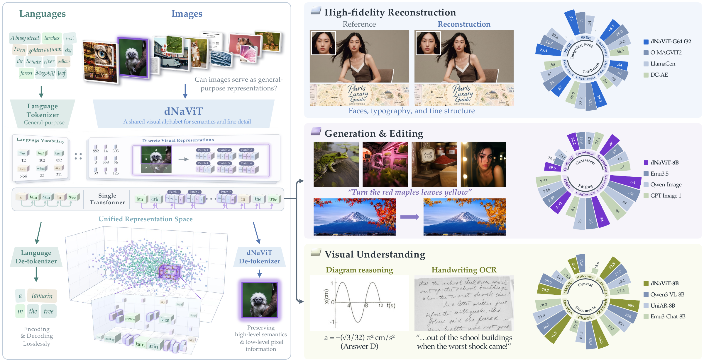
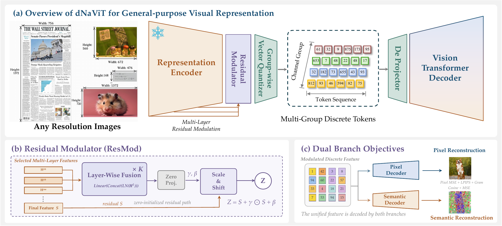
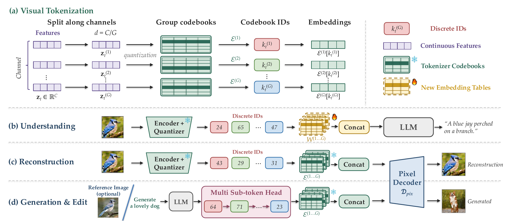
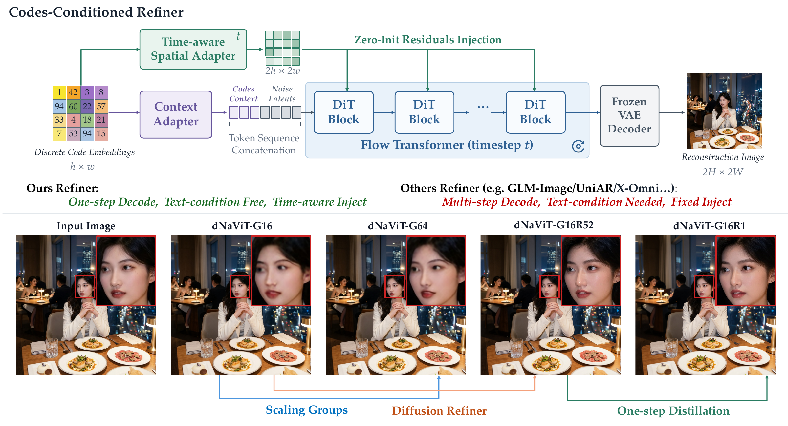

<!--
Copyright (c) 2026 LongCat dNaViT Team.
SPDX-License-Identifier: Apache-2.0
-->

<a id="dnavit"></a>

<div align="center">
  
</div>

<h1 align="center">dNaViT: Discrete Codes are General-Purpose Visual Representations</h1>

<h3 align="center">Meituan LongCat Team</h3>

<hr>

<p align="center">
  <a href="https://huggingface.co/meituan-longcat/LongCat-Next"></a>
  <a href="./"></a>
  <a href="https://arxiv.org/abs/2611.12426"></a>
</p>

<p align="center">
  <a href="https://lixiaotong97.github.io/dNaViT/"></a>
  <a href="./README.md"></a>
  <a href="#evaluation-results"></a>
  <a href="#training"></a>
</p>

<p align="center">
  <a href="#model-introduction">Introduction</a> &nbsp;·&nbsp;
  <a href="#evaluation-results">Results</a> &nbsp;·&nbsp;
  <a href="#quick-start">Quick Start</a> &nbsp;·&nbsp;
  <a href="#training">Training</a> &nbsp;·&nbsp;
  <a href="#evaluation">Evaluation</a> &nbsp;·&nbsp;
  <a href="#citation">Citation</a>
</p>

## Model Introduction

[](assets/figures/figure-1-teaser.pdf)

**Figure 1. A unified visual tokenizer for general-purpose modeling.** Native-resolution images are represented through a shared discrete vocabulary for reconstruction, understanding, generation, and editing. The figure summarizes the paper's tokenizer and downstream systems; see the repository scope below for the components included here.

We introduce **dNaViT**, a **Discrete Native-resolution Vision Transformer**
that turns native-resolution images into discrete visual primitives analogous
to language tokens. Building on our preliminary work in
[LongCat-Next](https://github.com/meituan-longcat/LongCat-Next), dNaViT explores
how far a finite discrete vocabulary can go in representing the richness of the
visual world: a shared interface for reconstruction, classification, multimodal
understanding, generation, and editing.

A frozen pretrained vision encoder supplies semantic features. A lightweight
**Residual Modulator (ResMod)** enriches these features with reconstruction-aware
detail, and **grouped product quantization** maps them to discrete codes.
Separate semantic and pixel reconstruction branches guide the shared
representation, while progressive training balances their objectives and
mitigates gradient interference. The same codes support faithful image decoding
and downstream token-based modeling; an optional code-conditioned Refiner
improves perceptual quality without changing the underlying representation.

<details>
<summary><strong>Figure 2: A shared representation for diverse downstream visual tasks</strong></summary>

[](assets/figures/figure-2-showcase.pdf)

**Figure 2. A unified discrete representation as a foundation for diverse downstream visual tasks.** Qualitative examples illustrate the versatility of the shared representation. These examples include downstream systems beyond the tokenizer implementation in this directory.

</details>

> **Directory scope.** This directory contains the tokenizer implementation,
> three training-stage configurations, and image reconstruction evaluation tools.
> Generative modeling code and pretrained tokenizer checkpoints are not bundled.
> The paper's downstream language-model experiments require additional components
> and training beyond this directory.

### Key Features

#### 🌟 Native-Resolution Visual Tokenization

dNaViT supports variable resolutions and aspect ratios rather than requiring a
single fixed square input. Smart resizing approximately preserves aspect ratios
and aligns image dimensions to the 32-pixel stride; variable-length packing
keeps training within a configurable token budget.
Image-specific token-grid dimensions are retained through quantization and
token unmerging, keeping both reconstruction branches spatially aligned with
the resized input across different resolutions and aspect ratios.

#### 🌟 Semantic Features with Reconstruction-Aware Detail

ResMod aggregates intermediate features from a frozen Qwen3-VL vision backbone
and learns token-wise residual scale-and-shift updates. Its zero-initialized
head preserves the pretrained semantic base at initialization, then learns to
incorporate complementary reconstruction-relevant detail without training the
backbone. Both decoders consume the same quantized embeddings: the semantic
branch reconstructs a fixed post-ResMod feature target using cosine and MSE
losses, while the pixel branch reconstructs the image.

[](assets/figures/figure-3-architecture.pdf)

**Figure 3. Architecture and residual modulation.** A frozen representation encoder and ResMod produce features for group-wise product quantization. ResMod fuses intermediate features through a zero-initialized scale-and-shift residual, while separate pixel and semantic ViT decoders supervise the shared discrete representation.

#### 🌟 Scalable Capacity through Grouped Product Quantization

Channel-wise codebooks increase discrete capacity without increasing the
spatial grid size. At stride 32, an image is represented on an
`H/32 × W/32` grid, with multiple code indices at each position. Increasing
the group count increases the code payload, not the number of spatial positions.

[](assets/figures/figure-4-tokenization.pdf)

**Figure 4. Tokenization and unified codes for downstream tasks.** Each spatial feature is split into channel groups and quantized with group-specific codebooks. Understanding supplies only the indices to the language model through newly initialized group-wise embedding tables trained jointly with the LM. Reconstruction looks up the frozen tokenizer's codebook embeddings. Generation and editing predict grouped indices through a multi-sub-token head and decode through the same tokenizer interface, optionally conditioned on a reference image. The downstream LM components shown here are not included in this directory.

#### 🌟 Progressive Three-Stage Training

Training proceeds from **continuous pixel pretraining (A)** to **discrete
semantic reconstruction (B)** and **joint reconstruction (C)**. Stage B stops
pixel gradients at the quantized representation; Stage C restores this path
and uses a frozen copy of the Stage B ResMod to keep semantic targets stable.
These correspond to **Stages 1, 2, and 3** in the manuscript; configuration
filenames retain the existing A/B/C names.

<details>
<summary><strong>Provided tokenizer configuration: G16, stride 32</strong></summary>

The provided Stage B and Stage C configurations use the following G16 setup:

| Component | Configuration |
| :--- | :--- |
| Vision backbone | Qwen3-VL ViT, frozen during training |
| Adapter | ResMod with intermediate-layer features |
| Spatial stride | 32, from 16-pixel patches and 2 × 2 merging |
| Latent dimension | 4096 |
| Product quantization | 16 groups, 256 dimensions per group |
| Codebook size | 16,384 entries per group |
| Code payload | 224 bits per spatial position, excluding storage overhead |
| Pixel decoder | ViT, width 1152, patch size 16 |

</details>

### Code-Conditioned Refiner

Although the ViT pixel decoder faithfully preserves image content, a Refiner
can further enhance perceptual quality with sharper, more realistic details.
Our **code-conditioned Refiner replaces the ViT pixel decoder** with a flow
decoder built on a pretrained image-generation prior. It conditions directly
on the discrete code embeddings, rather than an intermediate RGB reconstruction,
and requires no text conditioning. This separates the shared representation
from the choice of decoder while retaining the same underlying codes.

[](assets/figures/figure-6-refiner.pdf)

**Figure 6. Code-conditioned Refiner.** Discrete code embeddings condition a flow decoder through global context tokens and time-conditioned spatial residuals, without text conditioning. A multi-step teacher is distilled into a one-step student with adversarial supervision. Increasing the quantization group count improves reconstruction fidelity, while the G16 variant with the one-step Refiner enhances perceptual quality. The manuscript calls this refined variant **dNaViT-G16-R**.

> **Inference.** Refiner inference scripts are provided on Hugging Face. The G16/G64 reconstruction results below use the ViT pixel decoder **without refinement**.

Figure numbers follow the manuscript. Click any figure to view its original PDF; image sources and export settings are recorded in [assets/figures](assets/figures/README.md).

## Evaluation Results

The following results are reported in the manuscript
**dNaViT: Discrete Codes are General-Purpose Visual Representations**.
They describe trained models, not results from the bundled example data.
The paper-aligned descriptions, figures, and scores were checked against
manuscript revision `6dd4637` on **2026-11-09**.

### ImageNet Reconstruction

Evaluation uses all **50,000 ImageNet validation images**. Both variants use a
ViT pixel decoder **without refinement**, with spatial downsampling factor
**f = 32**. Higher is better for PSNR and SSIM.

| Model | Resolution | Spatial positions | PSNR (dB) ↑ | SSIM ↑ |
| :--- | :---: | ---: | ---: | ---: |
| dNaViT-G16 | 256 × 256 | 64 | 22.82 | 0.64 |
| dNaViT-G64 | 256 × 256 | 64 | 25.41 | 0.76 |
| dNaViT-G16 | 512 × 512 | 256 | 25.47 | 0.71 |
| dNaViT-G64 | 512 × 512 | 256 | 28.12 | 0.81 |
| dNaViT-G16 | 1024 × 1024 | 1,024 | 28.93 | 0.81 |
| dNaViT-G64 | 1024 × 1024 | 1,024 | 32.90 | 0.91 |

Spatial positions exclude quantization groups and do not specify bit rate.
G16 and G64 also differ in training configuration and duration, so these results
are not a controlled ablation of group count.

<details>
<summary><strong>Fine-grained reconstruction on TokBench</strong></summary>

Scores are macro-averages over the three official instance-scale buckets.
T-ACC and T-NED are percentages; F-Sim is cosine similarity. Higher is better
for all three metrics. Both variants use f = 32.

| Model | Resolution | T-ACC (%) ↑ | T-NED (%) ↑ | F-Sim ↑ |
| :--- | :---: | ---: | ---: | ---: |
| dNaViT-G16 | 512 × 512 | 33.58 | 52.43 | 0.34 |
| dNaViT-G64 | 512 × 512 | 51.69 | 68.72 | 0.54 |
| dNaViT-G16 | 1024 × 1024 | 45.05 | 62.75 | 0.41 |
| dNaViT-G64 | 1024 × 1024 | 63.08 | 78.27 | 0.67 |

</details>

<details>
<summary><strong>Image classification and distribution-shift transfer</strong></summary>

The manuscript evaluates frozen representations with a 16 × 16 spatial grid,
mean pooling, and a linear classifier trained on ImageNet-1K. Transfer uses
the same classifier without training on the target datasets. All scores are
top-1 accuracy (%); higher is better.

| Representation | ImageNet-1K | ImageNet-A | ImageNet-R | ImageNet-V2 | ImageNet-Sketch | ObjectNet |
| :--- | ---: | ---: | ---: | ---: | ---: | ---: |
| dNaViT-G16, continuous before quantization | 80.40 | 60.25 | 65.19 | 70.18 | 46.56 | 56.48 |
| dNaViT-G16, discrete | 79.47 | 56.35 | 68.09 | 69.81 | 45.02 | 59.79 |

Quantization reduces ImageNet-1K accuracy by 0.93 percentage points in this
comparison; transfer differences depend on the target distribution.

</details>

<details>
<summary><strong>Downstream visual understanding results</strong></summary>

The paper pairs the frozen dNaViT-G16 tokenizer with **Qwen3-8B** and performs
additional multimodal training. These scores belong to the resulting
**dNaViT-8B** system, not to the tokenizer alone.

| Benchmark | Score | Direction |
| :--- | ---: | :---: |
| MMMU | 70.7 | ↑ |
| MMMU-Pro | 44.5 | ↑ |
| MathVista | 79.0 | ↑ |
| MathVision | 56.5 | ↑ |
| RealWorldQA | 72.3 | ↑ |
| MMStar | 66.7 | ↑ |
| OCRBench | 885 | ↑ |
| OCRBench V2 (EN / ZH) | 57.6 / 60.1 | ↑ |
| CharXiv (DQ / RQ) | 86.5 / 51.0 | ↑ |
| DocVQA | 96.2 | ↑ |
| InfoVQA | 79.2 | ↑ |
| OmniDocBench (EN / ZH) | 0.17 / 0.22 | ↓ |

Scores use benchmark-specific scales and should not be averaged together.

</details>

<details>
<summary><strong>Downstream image generation and editing results</strong></summary>

The paper reports the following **dNaViT-8B** downstream results with the shared
discrete visual interface. Text-to-image generation uses **dNaViT-G16-R** for
code-conditioned decoding. These results require additional language-model
training and are distinct from the unrefined tokenizer reconstruction scores
above. Higher is better for the metrics below.

| Generation benchmark | Score |
| :--- | ---: |
| GenEval2 GM | 49.5 |
| Qwen-Image-Bench | 52.17 |
| SpatialGenEval | 0.68 |
| LongText-Bench (EN / CN) | 0.94 / 0.94 |

| Editing benchmark | Semantic consistency | Perceptual quality | Overall |
| :--- | ---: | ---: | ---: |
| GEdit-Bench, English full set | 7.41 | 7.20 | 7.30 |

The GEdit-Bench overall score is the benchmark-reported result, not a
recomputed arithmetic mean of its two component scores. Comparisons with other
models in the manuscript may involve different training data, sampling
configurations, and evaluation protocols; they are not controlled ablations.

</details>

## Quick Start

From the LongCat-Next repository root, enter the tokenizer directory before
following the installation, training, and evaluation commands below:

```bash
cd dNaViT
```

Use a separate environment for dNaViT; its dependencies are listed in
`dNaViT/requirements.txt`, independently of the repository root and `sft/`.

### 1. Install dependencies

Use Linux with an NVIDIA GPU and a CUDA-compatible PyTorch installation. The
dependency file records PyTorch 2.6.0 and Transformers 4.57.0 as the tested
versions. Python 3.10 or newer is recommended.

From the `dNaViT/` directory:

```bash
python -m venv ../dnavit-env
source ../dnavit-env/bin/activate
pip install -r requirements.txt
```

The vision backbone uses FlashAttention 2. Install a `flash-attn` build compatible
with your PyTorch and CUDA versions. If you keep the default experiment tracking
configuration, also install `wandb`:

```bash
pip install wandb
```

Alternatively, pass `training.enable_wandb=false` to the training launcher.

### 2. Prepare pretrained weights

Download the Qwen3-VL backbone and the auxiliary weights required by the training
losses. The default directory layout is:

```text
pretrained/
├── Qwen3-VL-8B-Instruct/
│   ├── config.json
│   └── model.safetensors*     # model weights and index, when sharded
├── vgg16-397923af.pth
├── convnext_small-0c510722.pth
├── vgg_lpips.pth
└── dino_vit_small_patch8_224.pth
```

| Weights | Purpose | Source |
| :--- | :--- | :--- |
| Qwen3-VL-8B-Instruct | Vision backbone | [Qwen3-VL](https://huggingface.co/Qwen/Qwen3-VL-8B-Instruct) |
| `vgg16-397923af.pth` | VGG perceptual and Gram losses | [PyTorch weights](https://download.pytorch.org/models/vgg16-397923af.pth) |
| `convnext_small-0c510722.pth` | ConvNeXt perceptual loss | [PyTorch weights](https://download.pytorch.org/models/convnext_small-0c510722.pth) |
| `vgg_lpips.pth` | LPIPS VGG linear weights | [LPIPS v0.1](https://github.com/richzhang/PerceptualSimilarity/blob/master/lpips/weights/v0.1/vgg.pth) |
| `dino_vit_small_patch8_224.pth` | Stage A discriminator initialization | [DINO](https://github.com/facebookresearch/dino) |

The Stage A configuration constructs the DINO discriminator at initialization,
even though adversarial updates start beyond its configured training duration.
The provided Stage B and Stage C configurations disable the discriminator.

To store the auxiliary loss weights elsewhere, set:

```bash
export DNAVIT_PRETRAINED=/path/to/auxiliary-weights
```

This environment variable controls auxiliary weights only. Set
`model.vq_model.qwen3vit_path` separately if the Qwen3-VL checkpoint is outside
`pretrained/Qwen3-VL-8B-Instruct/`. See [weight resolution](utils/paths.py) for details.

### 3. Prepare data

The provided configurations use a JSONL dataset with one image record per line:

```json
{"input": "<img_start>/path/to/image.jpg<img_end>", "source": "dataset_name", "img_size": [480, 640]}
```

The image path must appear inside `<img_start>...</img_end>`. Relative paths
resolve from the working directory. `img_size` stores the original `[height,
width]` and helps the sampler estimate token counts without decoding the image.

Set `dataset.params.jsonl_paths` in each stage configuration to your training
JSONL files. The files under [example_data](example_data/) illustrate the data
formats with one placeholder image; replace them with your training data.

<details>
<summary><strong>Resolution, batching, and validation data</strong></summary>

- `dataset.params.min_pixels` and `max_pixels` bound the resized image area.
- `dataset.params.max_tokens_per_sample` limits each image's token count.
- `training.max_batch_tokens` sets the packed batch budget. The JSONL loader
  uses this budget instead of `training.per_gpu_batch_size`.
- An optional `<fixres_256>` marker inside the image wrapper selects a fixed
  square resolution for that sample.
- For training-time PSNR evaluation, set `dataset.params.eval_data_path` to
  your validation images, or disable the monitor with `psnr_eval.enable=false`.
- Stage B and Stage C also enable linear probing. Set
  `linear_probe.imagenet_path` to an ImageFolder training dataset, or use
  `linear_probe.enable=false`.

For ImageFolder datasets, organize images as `<root>/<class_name>/<image>`.
The fixed-resolution training loader is available through `dataset.type=c2i`.

</details>

## Training

### Training stages

| Stage | Objective and gradient flow | Configuration |
| :--- | :--- | :--- |
| **A / 1 · Continuous pixel pretraining** | Bypass codebook quantization and jointly train ResMod and the pixel reconstruction path to expose reconstruction-relevant detail. | [Stage A](configs/dnavit_stageA_anyres_32x.yaml) |
| **B / 2 · Discrete semantic reconstruction** | Freeze ResMod and use its output as both the quantizer input and the fixed feature target. Train the quantizer and semantic decoder through feature reconstruction and quantization losses; pixel losses update only the branch consuming detached quantized embeddings. | [Stage B](configs/dnavit_stageB_anyres_g16_32x.yaml) |
| **C / 3 · Joint reconstruction** | Remove detachment from the pixel branch and jointly train the quantizer, both decoders, and student ResMod. A frozen Stage B teacher ResMod supplies the semantic target; the provided configuration trains the student ResMod at 0.1× learning rate. | [Stage C](configs/dnavit_stageC_anyres_g16_32x.yaml) |

The Qwen3-VL backbone remains frozen in all three provided configurations.

### Launch training

After configuring weight and dataset paths, run each stage from the `dNaViT/`
directory. These commands illustrate initialization from the preceding stage:

```bash
# Stage A: continuous autoencoder
NPROC=8 bash run_tok.sh configs/dnavit_stageA_anyres_32x.yaml

# Stage B: initialize from Stage A
NPROC=8 bash run_tok.sh configs/dnavit_stageB_anyres_g16_32x.yaml \
  experiment.init_weight_path=runs/dnavit_stageA_anyres_32x/exp1/checkpoint-latest/unwrapped_model

# Stage C: initialize from Stage B
NPROC=8 bash run_tok.sh configs/dnavit_stageC_anyres_g16_32x.yaml \
  experiment.init_weight_path=runs/dnavit_stageB_anyres_g16_32x/exp1/checkpoint-latest/unwrapped_model
```

`NPROC` selects the GPU count. `run_tok.sh` launches Accelerate, and additional
arguments override configuration values using OmegaConf dotlist syntax:

```bash
NPROC=4 bash run_tok.sh configs/dnavit_stageA_anyres_32x.yaml \
  'dataset.params.jsonl_paths=[/path/to/train.jsonl]' \
  model.vq_model.qwen3vit_path=/path/to/Qwen3-VL-8B-Instruct \
  training.max_batch_tokens=8192 \
  training.enable_wandb=false \
  psnr_eval.enable=false
```

<details>
<summary><strong>Checkpoints, resuming, and experiment tracking</strong></summary>

Training writes to `runs/<experiment.name>/<experiment.exp>/` by default.
Checkpoints are saved as `checkpoint-<step>/`, with `checkpoint-latest` pointing
to the most recent checkpoint.

With `experiment.resume=true`, restarting the same run resumes its saved
training state. An existing resumable checkpoint takes precedence over
`experiment.init_weight_path`, which initializes weights for a fresh run. Use a
new experiment name or output directory when starting a separate experiment.

The launcher defaults to `WANDB_MODE=offline`. Set `WANDB_MODE=online` to enable
online tracking when using W&B.

</details>

## Evaluation

### ImageNet-256 reconstruction

The evaluation script resizes each image's shorter edge to 256 pixels, applies a
256 × 256 center crop, and compares the reconstruction with that same crop.
It reports **PSNR** and **SSIM**, with reconstructed pixels rounded to the 8-bit
grid. Optional **rFID** compares reconstructed and reference Inception features.

```bash
# PSNR and SSIM on one GPU
bash eval_tok.sh configs/dnavit_stageC_anyres_g16_32x.yaml \
  /path/to/checkpoint/ema_model /path/to/imagenet/val 256

# Add rFID and distribute evaluation across four GPUs
FID=1 NPROC=4 bash eval_tok.sh configs/dnavit_stageC_anyres_g16_32x.yaml \
  /path/to/checkpoint/ema_model /path/to/imagenet/val 256
```

Use a checkpoint compatible with the selected configuration. `--ckpt` accepts
a weight file or a directory containing `pytorch_model.bin`, such as
`unwrapped_model/` or `ema_model/`. rFID requires `pytorch-fid` and its Inception
weights.

For configuration overrides or a saved metrics file, use the Python entry point:

```bash
python scripts/eval_recon.py \
  --config configs/dnavit_stageC_anyres_g16_32x.yaml \
  --ckpt /path/to/checkpoint/ema_model \
  --data-path /path/to/imagenet/val \
  --image-size 256 --bf16 --fid \
  --result-file reconstruction_metrics.txt \
  --override model.vq_model.qwen3vit_path=/path/to/Qwen3-VL-8B-Instruct
```

The wrapper also accepts `BATCH` for per-GPU batch size and `NUM_SAMPLES` for a
smaller evaluation subset. Use the complete validation set for benchmark results.

## Repository Structure

```text
configs/         Three-stage training configurations
data/            Variable-resolution JSONL and ImageFolder loaders
modeling/        Tokenizer, quantizers, ResMod, and decoder modules
utils/           Training utilities, checkpointing, and evaluation monitors
evaluator/       Reconstruction metrics and Inception feature extraction
scripts/         Training and reconstruction evaluation entry points
example_data/    Minimal examples of the supported data formats
run_tok.sh       Distributed training launcher
eval_tok.sh      Reconstruction evaluation launcher
```

## License Agreement

The project's license is **Apache-2.0**; see [LICENSE](LICENSE).
Third-party components and externally downloaded model weights remain subject
to their respective licenses.

## Citation

We kindly encourage citation of our work if you find it useful.

```bibtex
@misc{li2026dnavitdiscretecodesgeneralpurposevisual,
      title={dNaViT: Discrete Codes are General-Purpose Visual Representations},
      author={Xiaotong Li and Zhengrong Yue and Xu Huang and Jialv Zou and
              Minhao Jing and Wenhao Yan and Haodong Li and Hai Huang and
              Bo Zhao and Yan Feng and Peng Pei and Xunliang Cai},
      year={2026},
      eprint={2611.12426},
      archivePrefix={arXiv},
      primaryClass={cs.CV},
      url={https://arxiv.org/abs/2611.12426},
}
```

## Contributing

Issues and pull requests are welcome. For bug reports, include the configuration,
dependency versions, launch command, and relevant error log so the problem can
be reproduced.
